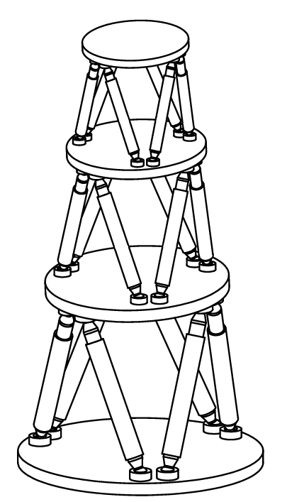
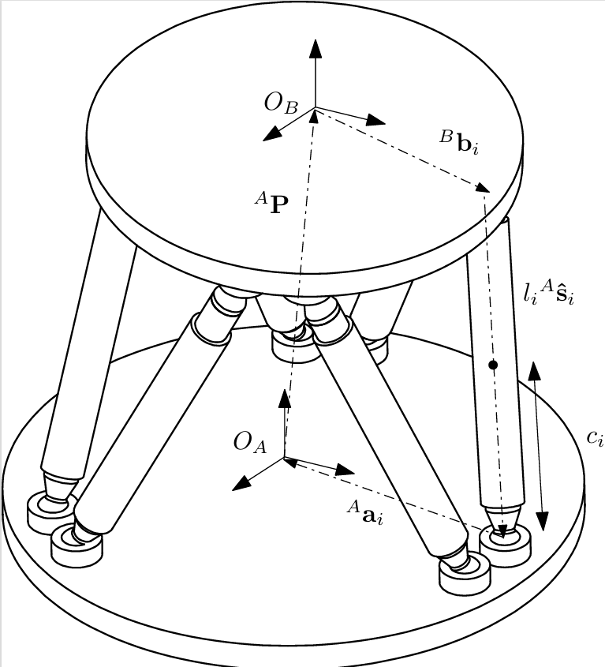
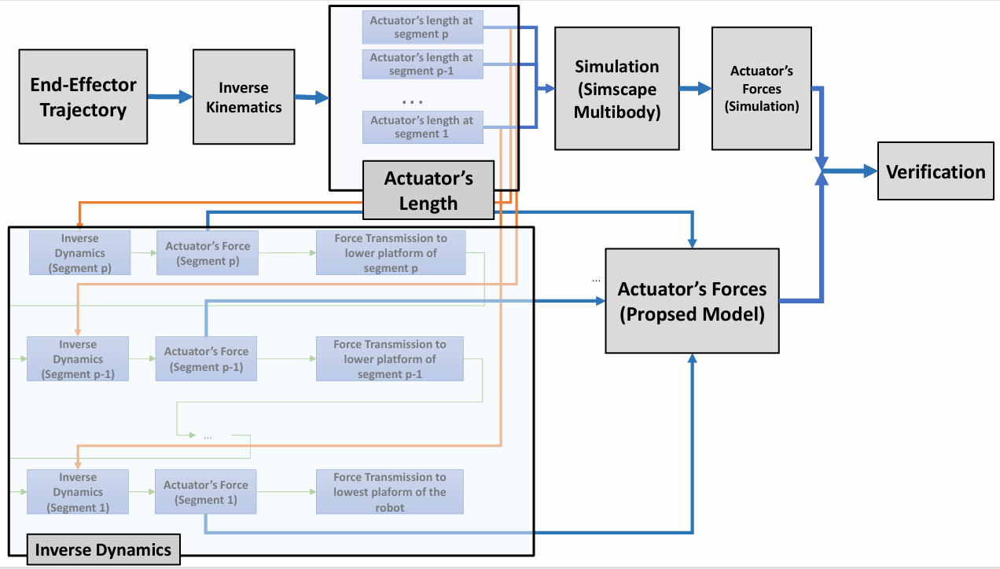
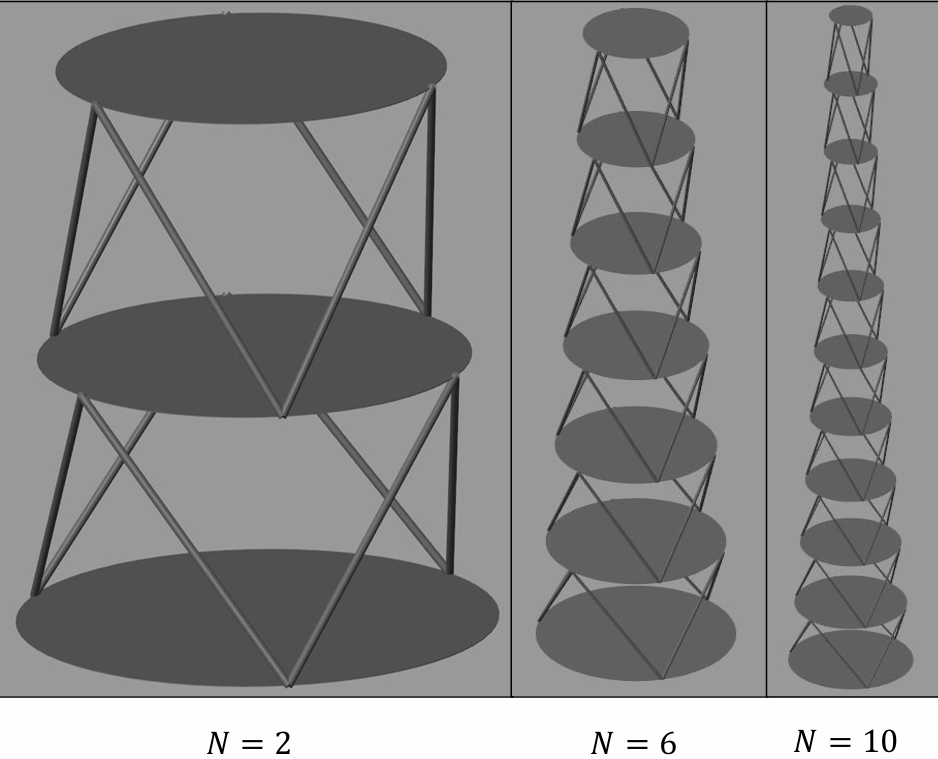

# Dynamic modeling of serially connected Gough–Stewart robots

**Research project · University of Tehran / Human and Robot Interaction Laboratory**

A stack of Gough–Stewart stages combines six-actuator parallel mechanisms into a serial robot. This repository presents the earlier dynamic-modeling case studies and the subsequent research direction on generalized inverse dynamics and base inertial parameters (BIPs).

  

**Explore:** [Research overview](#research-overview) · [Validation](#validation) · [Repository files](#repository-files) · [Videos](#videos) · [Publications](#publications-and-status)

## Research overview

Each moving stage has six cylinder-piston actuators, with universal joints at the lower platform and spherical joints at the upper platform. Prescribed platform motion determines the limb kinematics. In inverse dynamics, platform, cylinder, piston, and transmitted wrenches are assembled stage by stage from the end effector toward the base to obtain all $6N$ actuator forces for $N$ stages.

  
  

The **earlier thesis and conference study** examined 2-, 6-, and 10-stage robots under spiral, vertical, and lemniscate motions. The **follow-on IJRR manuscript** extends the formulation to BIP reduction and evaluates 2- and 6-stage examples. These studies use different analyses and result sets; the figures and summary CSV in this repository belong to the earlier study.

In the follow-on formulation, each stage contributes 13 moving rigid bodies and 130 primary inertial parameters. For the tested chirp excitation, the 2-stage and 6-stage observation matrices retain 155 and 471 *numerical* BIPs, respectively. The observed count follows $76 + 79(N-1)$ for the tested cases; this is not a claim of universal structural minimality.

## Validation

The follow-on study checks three distinct questions:

1. **Dynamic-model agreement:** compare nominal analytical actuator forces with Simscape Multibody under the same prescribed motions.
2. **Parameter reduction:** reconstruct full-model forces from the reduced BIP representation on chirp and a separate spiral trajectory, and recover known BIPs from simulated forces.
3. **Parameter equivalence:** compare physically admissible original and alternative inertial parameter sets that share BIPs, including a separate Simscape-to-Simscape check.

Selected **nominal analytical–Simscape** results from the follow-on manuscript:

| Stages | Motion | Force RMSE (N) | Relative force error |
| ---: | --- | ---: | ---: |
| 2 | Spiral | 1.93 | 1.86% |
| 2 | Lemniscate | 0.27 | 0.41% |
| 6 | Spiral | 26.67 | 6.71% |
| 6 | Lemniscate | 2.74 | 1.89% |

The manuscript also reports vertical tests with errors below its displayed two-decimal precision. Relative force error is normalized by the analytical force norm over the interior trajectory samples. Small within-model BIP reconstruction residuals measure a **different** comparison and should not be read as analytical–Simscape accuracy. The current simulations assume rigid bodies and omit friction, compliance, and measurement noise.

  

*The 2-, 6-, and 10-stage illustrations above come from the earlier study; the follow-on BIP examples use 2 and 6 stages.*

## Repository files

This repository currently contains figures, presentation material, an earlier error summary, and simulation videos. **It does not contain a runnable MATLAB/Simscape source package or the complete follow-on IJRR datasets.**

| Item | Contents |
| --- | --- |
| [Presentation](presentation.pdf) | Slide deck for the earlier project |
| [Case-study figure](img/3CaseStudy.png) and [trajectories](img/trajectories.png) | Earlier robot configurations and prescribed motions |
| [Force comparison](img/Forces_NumPlat10_Platform1_MotionSpiral.png) | Earlier 10-stage spiral example |
| [Error heat map](img/HeatMap_NumPlat10_MotionLeminscate.png), [box plot](img/BoxPlot_NumPlat10_MotionLeminscate.png), and [summary](img/error_summary_full.png) | Earlier study's error visualizations |
| [Summary CSV](error_summary_formatted.csv) | Original exported summary; some column labels are not reliably encoded, so consult the figures and presentation for interpretation |
| [CAD rendering](img/Solid.png) and [prototype image](img/GS_Behdad.png) | Mechanical design and lab hardware |

The source PDFs for many figures are in the repository root. The `img/` directory holds preview images used on this page.

## Videos

- [Spiral simulation](Spiral%20Simulation.avi)
- [Lemniscate simulation](Leminscate%20Simulation.avi) — the original filename uses this spelling.

These are visualization files from the earlier case studies; they are not a substitute for the numerical model.

## Publications and status

- **Earlier study:** [ICRoM 2024 conference publication](https://ieeexplore.ieee.org/document/10903648/). The repository's presentation and 2/6/10-stage visuals relate to this project phase.
- **Follow-on study:** *Generalized dynamic modeling and base inertial parameters of a serially connected Gough–Stewart robotic manipulator* (IJRR manuscript under development; publication status is not asserted here). Its numerical values above are drawn from the local manuscript and should be cited from the final paper once available.

Contributors to the follow-on manuscript include Hossein Akbari, Alireza Kamali Ardakani, Behzad Danaei, Ehsan Hosseinian, and Mehdi Tale Masouleh. For formal author order and affiliations, use the final submitted manuscript.

## Scope and limitations

The numerical BIP ranks depend on the excitation, scaling, cutoff, and limb-motion model. Experimental parameter identification remains future work. If you need to reproduce the manuscript's results, request the corresponding MATLAB source, Simscape models, parameter tables, and datasets from the authors; this repository snapshot alone is insufficient.
